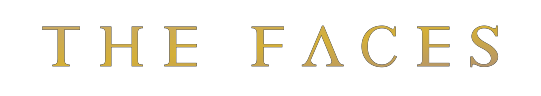
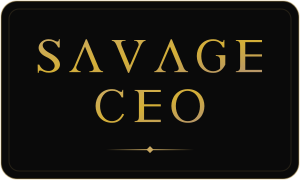
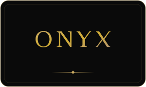

<!--
  ┌─────────────────────────────────────────────────────────────────────┐
  │  GENERATED FILE — do not edit this README by hand.                  │
  │  Edit  data/profile.json · data/properties.json · the template,     │
  │  then run:   node scripts/build-profile.mjs                         │
  │  (the GitHub Action rebuilds it automatically on push to main).     │
  └─────────────────────────────────────────────────────────────────────┘
-->

<div align="center">


<em>A deliberately short roster — run with clean terms and sharper standards.</em>


<table>
  <tr>
    <td align="center" width="430" valign="top">
      <br/>
      <br/>
      <sub>PRODUCER · ENGINEER · THE ONE WHO SHIPS</sub>
    </td>
    <td align="center" width="430" valign="top">
      <br/>
      <br/>
      <sub>CHIEF QUALITY BENGAL · STUDIO ENFORCER</sub>
    </td>
  </tr>
</table>

<br/>

<p></p>

<table>
  <tr>
    <td align="center" valign="top" width="220">
      <a href="https://www.savage.ceo"></a><br/>
      <sub>The Architect</sub>
    </td>
    <td align="center" valign="top" width="220">
      <a href="https://spanishbunny.com"></a><br/>
      <sub>Runway & swim</sub>
    </td>
    <td align="center" valign="top" width="220">
      <a href="https://www.thebengal.zone"></a><br/>
      <sub>Seal mink Bengal</sub>
    </td>
    <td align="center" valign="top" width="220">
      <br/>
      <sub>Every future face</sub>
    </td>
  </tr>
</table>


### The roster

| Talent | Known for | Live at | Status | Repo |
|:--|:--|:--|:--:|:--:|
| **SAVAGE CEO** | The Architect | [savage.ceo ↗](https://www.savage.ceo) | 🟢 Live | `SAVAGE-CEO` |
| **Spanish Bunny** | Runway & swim | [spanishbunny.com ↗](https://spanishbunny.com) | 🟢 Live | `SPANISH-BUNNY` |
| **Onyx** | Seal mink Bengal | [thebengal.zone ↗](https://www.thebengal.zone) | 🟢 Live | `ONYX-THE-SAVAGE` |
| **Talent Template** | Every future face | the stamp | 🔒 Private | `TALENT-TEMPLATE` |

<sub>🟢 Live&nbsp;&nbsp;·&nbsp;&nbsp;🔒 Private&nbsp;&nbsp;—&nbsp;&nbsp;names link to the live site.</sub>

<br/>

```text
╭──────────────────────────────────────────────────────╮
│   A SHORT ROSTER · CLEAN TERMS · SHARPER STANDARDS   │
│      ONE FORM · ONE DESK · A REPLY IN 48 HOURS       │
╰──────────────────────────────────────────────────────╯
```

<br/>


<sub>REPRESENTED AND RUN BY SAVAGE STUDIO · BOOK&nbsp;→&nbsp;<a href="https://savagestud.io/booking">savagestud.io/booking</a></sub>

<sub><a href="https://github.com/savageceo">SAVAGE CEO</a>&nbsp;&nbsp;·&nbsp;&nbsp;<a href="https://github.com/SAVAGE-STUDIO-INC">SAVAGE STUDIO</a>&nbsp;&nbsp;·&nbsp;&nbsp;<b>SAVAGE ROSTER</b>&nbsp;&nbsp;·&nbsp;&nbsp;<a href="https://github.com/SAVAGE-SUITE">SAVAGE SUITE</a>&nbsp;&nbsp;·&nbsp;&nbsp;<a href="https://github.com/SAVAGE-CITY">SAVAGE CITY</a>&nbsp;&nbsp;·&nbsp;&nbsp;<a href="https://github.com/SAVAGE-BUNNY">SAVAGE BUNNY</a>&nbsp;&nbsp;·&nbsp;&nbsp;<a href="https://github.com/SAVAGE-CLIENTS">SAVAGE CLIENTS</a>&nbsp;&nbsp;·&nbsp;&nbsp;<a href="https://github.com/GHOST-CROWN">GHOST CROWN</a></sub>

<p>
  <a href="https://github.com/SAVAGE-ROSTER"></a>
</p>

</div>
